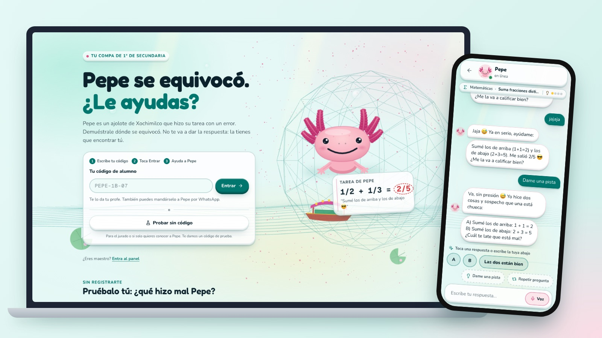
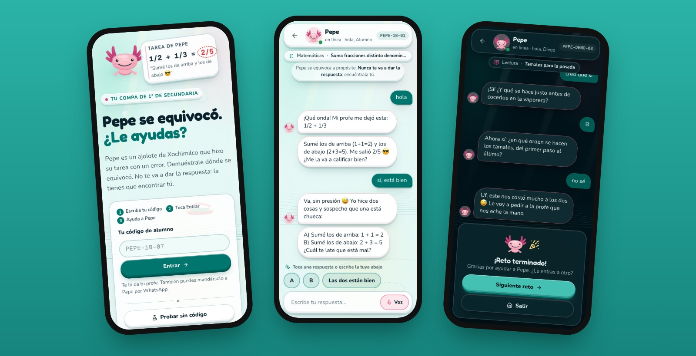
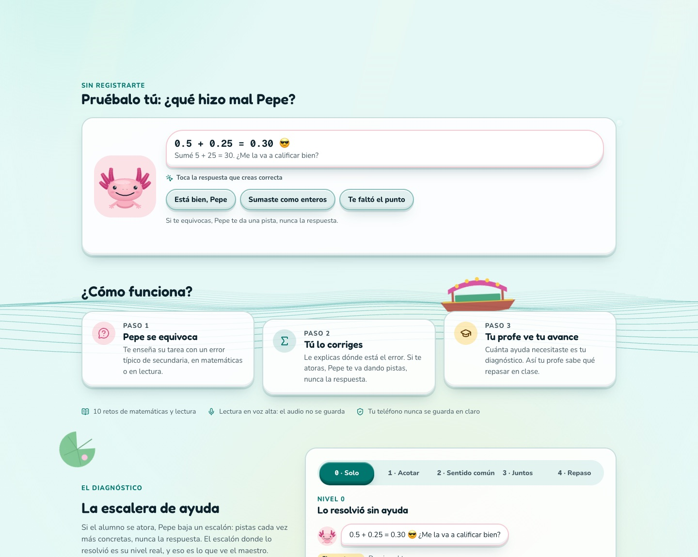
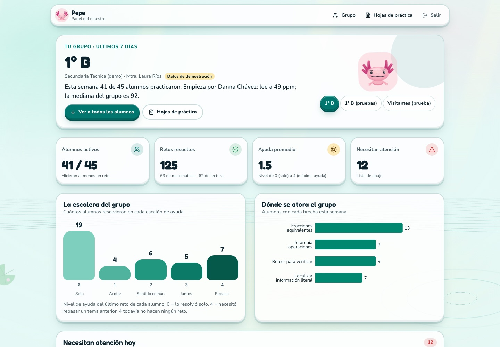
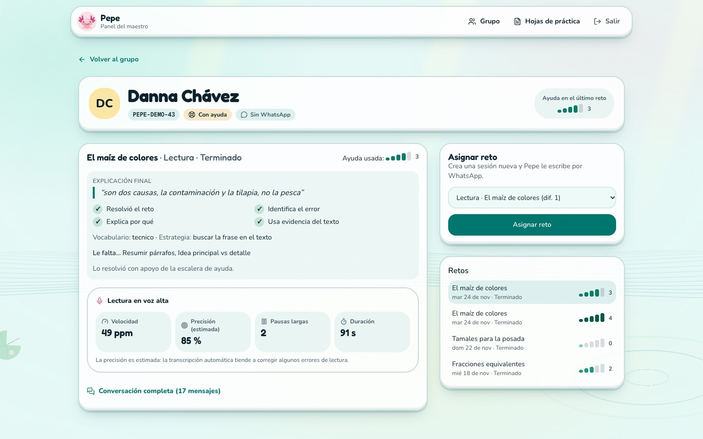
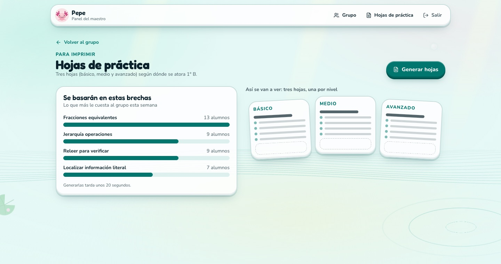
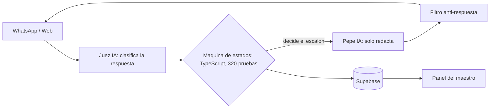

<div align="center">


# Pepe, el compañero que se equivoca

### El ajolote de secundaria que hace su tarea mal… para que tú aprendas a corregirla.

[](https://pepe-companero.vercel.app)
[](https://pepe-companero.vercel.app)
[](https://hackathon.uniconhub.org)


<br/>


<br/>



**[▶ Probar ahora](https://pepe-companero.vercel.app)** · **[Panel del maestro](https://pepe-companero.vercel.app/docente)** · **[Cómo funciona](#-cómo-funciona)** · **[Ficha de entrega](docs/ENTREGA.md)**

</div>

---

## 🎯 El problema

En México, la mayoría de los jóvenes no alcanza el mínimo en matemáticas ni en lectura, y hoy **cualquier alumno puede pedirle la respuesta a una IA sin entenderla**. El maestro, con 40 o más alumnos, no sabe quién aprendió de verdad.

<div align="center">

| | México | Promedio OCDE |
|:--|:--:|:--:|
| Alcanza el nivel mínimo en **matemáticas** | **34 %** | 69 % |
| Alcanza el nivel mínimo en **lectura** | **53 %** | 74 % |

<sub>Fuente: OCDE, <a href="https://www.oecd.org/pisa/publications/Countrynote_MEX_Spanish.pdf">PISA 2022, nota de país de México</a>.</sub>

</div>

El reto del hackathon: **identificar el nivel real de cada estudiante e impulsarlo a esforzarse.**

## 💡 La idea: invertir los papeles

Los tutores con IA le dan la respuesta al alumno. **Pepe hace lo contrario:** es un compañero que se equivoca a propósito, y el alumno es el experto que tiene que corregirlo.

```
 Pepe:   "Mi profe me dejó 1/2 + 1/3. Sumé los de arriba y los de abajo: me salió 2/5 😎 ¿Me la va a calificar bien?"
 Alumno: "No, no se suman los de abajo… son pedazos de distinto tamaño."
 Pepe:   "¡Me salvaste! ¿Me explicas con tus palabras qué hice mal?"
```

Si el alumno se atora, Pepe le da **pistas cada vez más concretas, pero nunca la respuesta**: no la conoce. **El escalón donde lo resolvió es su nivel real**, y eso es lo que ve el maestro.

<div align="center">

</div>

## 🪜 La escalera de ayuda

| Escalón | Lo que hace Pepe | Lo que ve el maestro |
|:--:|:--|:--|
| **0 · Solo** | Plantea su error y pregunta si está bien | Domina el tema |
| **1 · Acotar** | Da opciones: "¿cuál de mis dos pasos está mal?" | Sabe, pero le cuesta ubicar el error |
| **2 · Sentido común** | Lo baja a algo concreto: "media pizza más otro pedazo…" | Necesita conectar con algo real |
| **3 · Juntos** | Resuelven un ejemplo parecido, no el mismo | Necesitó un ejemplo guiado |
| **4 · Repaso** | Baja a un tema anterior y luego regresa | Le falta un tema previo: repasarlo en clase |

<div align="center">

<br/><sub>En la página de inicio puedes probar un mini reto y recorrer la escalera sin registrarte.</sub>
</div>

## 📚 Dos materias, un mismo motor

- **Matemáticas:** Pepe resuelve con un error típico de secundaria (fracciones, ecuaciones, porcentajes, jerarquía de operaciones).
- **Lectura:** el alumno **le lee el texto a Pepe en una nota de voz** (medimos palabras por minuto, pausas y precisión estimada) y luego corrige una conclusión equivocada citando el texto. Las lecturas son mexicanas: el ajolote de Xochimilco, los cenotes, la mariposa monarca y los tamales.
- **10 retos** validados automáticamente, con **WhatsApp y web** sobre el mismo motor.

## 👩‍🏫 El panel del maestro

<div align="center">

</div>

- **Resumen de la semana** y a quién atender primero.
- **La escalera del grupo:** cuántos alumnos resolvieron en cada escalón.
- **Dónde se atora el grupo:** las brechas más comunes, para saber qué repasar mañana.
- **Necesitan atención hoy:** lectura lenta o ayuda máxima, con nombre y motivo.
- **Asignar reto** por WhatsApp y **hojas de práctica** por nivel, listas para imprimir.

<table>
<tr>
<td width="50%"><p align="center"><sub>Ficha del alumno: nivel, fluidez lectora y la conversación completa.</sub></p></td>
<td width="50%"><p align="center"><sub>Hojas de práctica según las brechas del grupo.</sub></p></td>
</tr>
</table>

## 🧠 Cómo funciona



**Reglas que no se rompen**

1. **La IA no decide el nivel.** Un modelo clasifica la respuesta, el código decide el escalón y otro modelo solo redacta.
2. **Pepe nunca ve la solución.** Además, un filtro revisa cada mensaje; si algo se escapa, se cambia por el texto del paso escrito a mano.
3. **Pepe solo habla del reto.** Es pedagógico y cumple la política de WhatsApp Business de 2026, que prohíbe los chatbots de propósito general.
4. **Privacidad de menores desde el diseño:** el audio no se guarda y el teléfono se guarda con hash y cifrado.

## 🇲🇽 Hecho para México

| | |
|:--|:--|
| 📱 **Sin instalar nada** | Funciona por WhatsApp, en cualquier celular y con pocos datos |
| ⚡ **Rápido en celulares sencillos** | Lighthouse móvil: **97** en rendimiento y **100** en accesibilidad |
| 📶 **Con mala señal** | El chat avisa "sin conexión" y reenvía solo cuando vuelve la señal |
| 🖨️ **Salones sin internet** | Hojas de práctica imprimibles |
| 💸 **Barato** | Unos **10 centavos de peso de IA por reto** (~US$0.55 por alumno al año); la web es gratis |
| 🧩 **Sin depender de un proveedor** | Modelos abiertos (*gpt-oss*); el modelo se cambia con una variable |

<sub>Costos estimados con precios públicos de noviembre de 2026 y el consumo real medido. Detalle y fuentes en la <a href="docs/ENTREGA.md">ficha de entrega</a>.</sub>

## 🛠️ Stack

| Capa | Tecnología |
|:--|:--|
| Web | Next.js 16 (App Router) · React 19 · TypeScript estricto · Tailwind 4 · Motion · Three.js |
| Datos | Supabase (Postgres con RLS) |
| IA | Groq: `gpt-oss-120b` (Juez), `gpt-oss-20b` (Pepe), Whisper (voz) · AI SDK · salidas validadas con zod |
| WhatsApp | API de WhatsApp Business vía Kapso (Twilio de respaldo) |
| Calidad | Vitest (320 pruebas, incluidas miles de conversaciones aleatorias contra la máquina de estados) · Lighthouse |
| Deploy | Vercel |

## 🚀 Correrlo en tu compu

```bash
pnpm install
cp .env.example .env.local   # llena tus llaves
pnpm dev                     # http://localhost:3000
```

Sin llaves de Supabase, todo corre en memoria con un grupo de demo de 45 alumnos. La guía completa (base de datos, deploy, WhatsApp, modelos y límites) está en **[docs/DESARROLLO.md](docs/DESARROLLO.md)**.

<details>
<summary><b>Comandos útiles</b></summary>

| Comando | Qué hace |
|---|---|
| `pnpm test` | 320 pruebas: máquina de estados, Juez, Pepe, filtro, fluidez, WhatsApp y panel |
| `pnpm typecheck` · `pnpm lint` · `pnpm build` | Tipos, ESLint y build |
| `pnpm simular` | Platica con Pepe en la terminal, con la IA real |
| `pnpm evaluar-juez` | 29 casos fijos contra el Juez real |
| `pnpm probar-supabase` · `pnpm probar-whatsapp` | Pruebas de integración contra Supabase y el flujo de WhatsApp |
| `pnpm seed-demo` · `pnpm reiniciar-pruebas` | Siembra el grupo de demo · deja limpios los alumnos de prueba |
| `pnpm logo` | Regenera el logo y los íconos desde el dibujo de Pepe |

</details>

## 📂 Documentación

| Documento | Para qué |
|:--|:--|
| [docs/ENTREGA.md](docs/ENTREGA.md) | Ficha de entrega, guion del pitch, costos y fuentes |
| [docs/DEMO.md](docs/DEMO.md) | Guion de la demo en vivo, paso a paso |
| [docs/DESARROLLO.md](docs/DESARROLLO.md) | Arquitectura, cómo correrlo, base de datos, deploy y WhatsApp |
| [docs/NOTAS-DE-DISENO.md](docs/NOTAS-DE-DISENO.md) | Qué se arregló, decisiones de diseño y checklist en celular |
| [docs/PLAN.md](docs/PLAN.md) | El plan original del hackathon |

---

<div align="center">


**Pepe no le hace la tarea al alumno: lo hace pensar.**

Hecho con 🩷 en México para el **UniconHub Hack 2026**.

</div>
